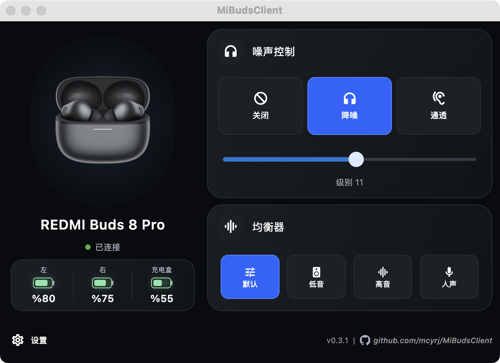

# MiBudsClient for macOS

我自己用的是 **REDMI Buds 8 Pro**。平时用 Mac，想看看耳机和充电盒还剩多少电、切一下降噪，却没找到合适的桌面工具。后来看到 Cesur Polat 开源的 MiBudsClient，就拉了份源码，改到能在自己的 Mac 上用。现在把改好的版本放出来，给国内用小米和红米耳机的朋友一起用。

[**下载 macOS 版（Apple 芯片）**](https://github.com/mcyrj/MiBudsClient/releases/latest) · [安装与使用说明](docs/readme/README.zh-CN.md)

*macOS 主界面，图中电量为示例。*

感谢 **Cesur Polat** 和贡献者开发原版。本项目沿用 GPLv3 许可证，并保留原项目署名。[原项目](https://github.com/CesurPolat/MiBudsClient) · [许可证](LICENSE) · [署名与改动记录](NOTICE.md)
